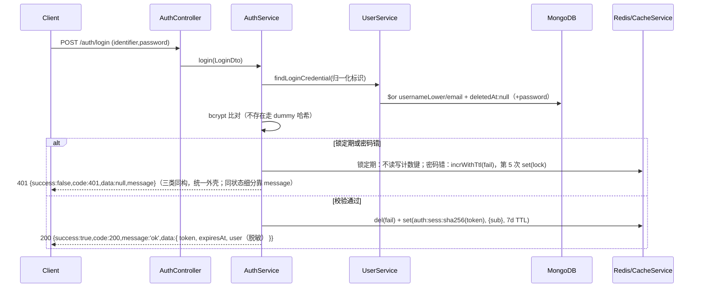
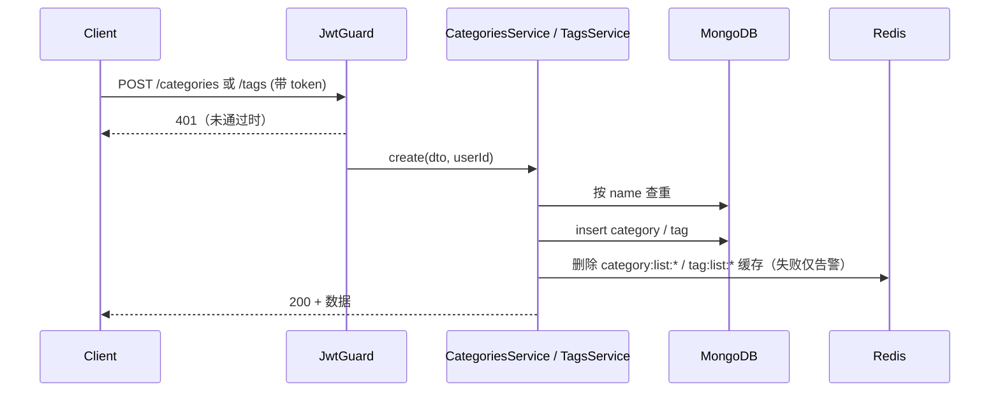
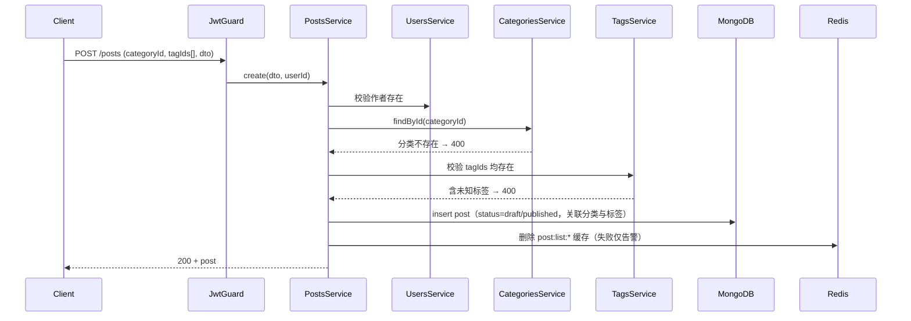
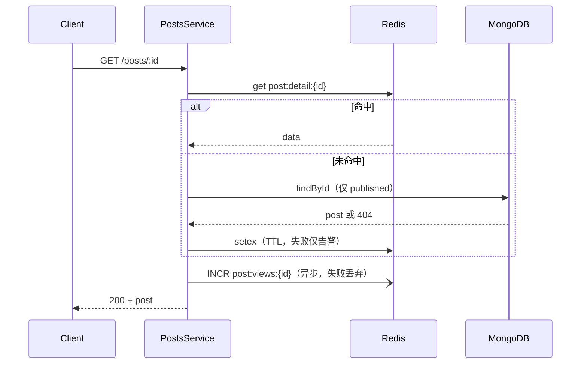
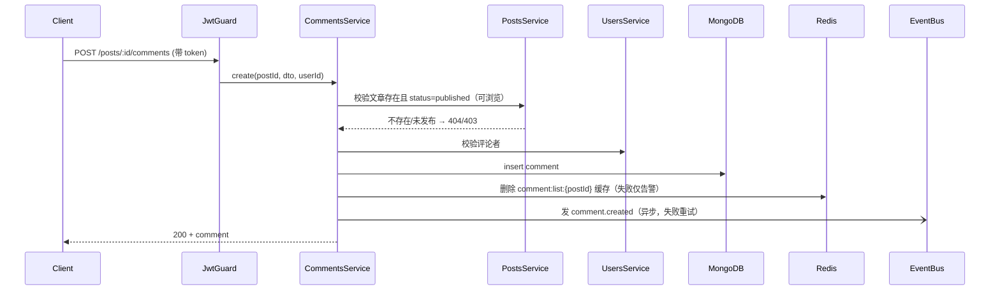

# 关键数据流

> 文件介绍：记录核心用例在模块间的执行顺序。
> 使用场景：改调用链路、排查某请求从头到尾如何流转时读。
> 状态：Draft（对应模块尚未全部落地，先按规划记录）。
> 维护规则：代码改调用链路，本文件必须在同一 PR 更新，否则不予合并。
> 配套文档：模块清单、依赖方向与演进顺序见 [module-dependencies.md](./module-dependencies.md)。

## AI 阅读指引

- 不要顺序通读，按任务直接跳到对应用例。
- 每条流必须标清：同步还是异步、缓存在哪一步、失败如何降级。

业务主线：**登录 → 新建分类标签 → 按已有分类标签发文 → 浏览文章 → 发表评论**。

### 1. 登录（前置：拿凭证，后续写操作全靠它）

- 同步链路；会话写 Redis 失败即 500，**不降级**（fail-closed，FR-015）。
- 令牌为不透明随机串，Redis 只存其 sha256 摘要对应的 `SessionPayload{sub}`（ADR-004）。
- 账号不存在/软删仍执行一次 dummy bcrypt 比对均化时序；错误密码、不存在、锁定期对外统一 401 `INVALID_CREDENTIALS`。
- 连续失败 5 次锁 15 分钟（计数滑动窗口 + 锁定固定窗口，键均在 Redis）；锁定期仍跑 bcrypt 但不计次/不延长，真实原因只入服务端日志。

> 鉴权回查：受保护请求经全局 `AuthGuard` 解析 Bearer → `resolveSession` 查 Redis → `UserService.getAuthPrincipal(sub)` 回查 Mongo 当前 `isAdmin`（软删即时 401、降权即时 403）→ 注入 `request.user`。登出 `POST /auth/logout` 仅 `del` 当前令牌会话键，即时吊销、多会话互不影响。

### 2. 新建分类 / 标签（阶段 2：同步重名校验 → 写库 → 失效列表缓存）

- 同步链路；分类与标签走同一套流程（仅 Service / 缓存前缀不同）。
- 缓存删除失败不影响创建，靠 TTL 自然过期兜底。

### 3. 发布文章（阶段 3：必须挂已有分类，可带已有标签）

- 同步链路；分类不存在直接 400；任一标签不存在返回 400（不自动新建）。
- 缓存删除失败靠 TTL 兜底。

### 4. 浏览文章（阶段 4：cache-aside，浏览计数异步累加）

- 读详情走同步 cache-aside；浏览数 +1 走异步（Redis `INCR` 或事件），不阻塞响应。
- Redis 整体故障降级为直读 MongoDB；计数失败丢弃本次累加，不影响返回。

### 5. 发表评论（阶段 4：文章须已发布、可浏览）

- 同步校验 + 写库；文章不存在或未发布返回 404/403；缓存删除失败靠 TTL 兜底。
- 外部副作用（邮件通知作者等）走异步事件，失败重试，不阻塞主流程。

## 降级总则

- 主链路（校验 + 写库）全部同步，任何一步失败即返回错误，不写半成品。
- Redis 只做缓存 / 计数：写后失效失败一律仅告警，靠 TTL 兜底，不阻断主流程。
- 外部调用（邮件、搜索索引、计数）走异步事件，失败重试，不阻塞主流程。

## 更新记录

> 只记重要变更，最新在上。完整历史见 Git。

- 2026-10-11 @架构组：初版：Users → Posts → Comments 三阶段
- 2026-10-11 @架构组：按业务主线改为：新建分类标签 → 挂归属发文 → 浏览 → 评论
