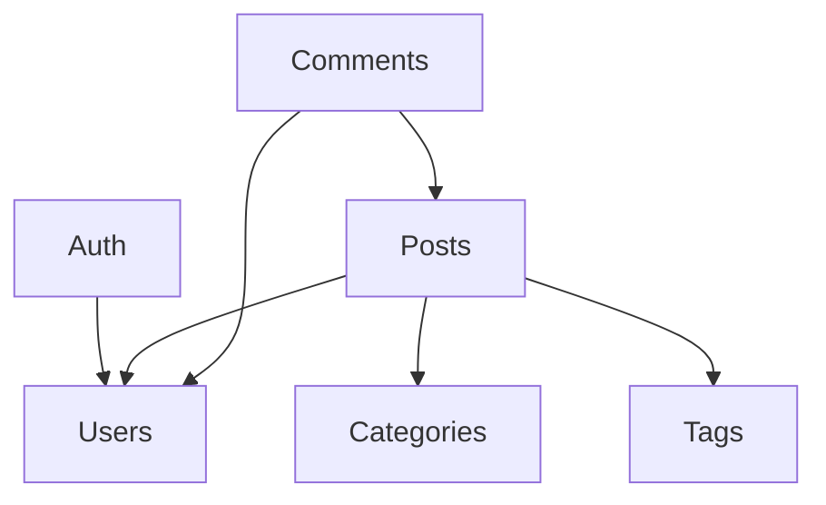

# 模块依赖

> 文件介绍：记录当前 Nest 模块清单、依赖方向与演进顺序。
> 使用场景：新增模块、拆分模块、排查跨模块影响、评估改动牵动范围时读。
> 状态：Draft（对应模块尚未全部落地，先按规划记录）。
> 维护规则：代码改模块结构，本文件必须在同一 PR 更新，否则不予合并。
> 配套文档：核心用例执行顺序见 [data-flows.md](./data-flows.md)。

## AI 阅读指引

- 不要顺序通读，按任务读对应节。
- 了解有哪些模块：读「模块地图」。
- 判断能否依赖某模块 / 是否成环：读「依赖图」与「依赖矩阵」。

## 模块演进

业务主线：**先建分类 → 按已有分类发文 → 文章被浏览 → 才能评论**。按落地顺序：

| 阶段 | 新增模块                          | 说明                                                   |
| ---- | --------------------------------- | ------------------------------------------------------ |
| 1    | `UsersModule` + `AuthModule`      | 用户与认证先行，是后续一切写操作的前提                 |
| 2    | `CategoriesModule` + `TagsModule` | 分类标签必须先于文章存在，发文时只允许挂已有分类与标签 |
| 3    | `PostsModule`                     | 发文依赖 Users（作者）与分类标签（归属校验）           |
| 4    | `CommentsModule`                  | 文章发布并可被浏览后才开放评论，依赖 Posts 与 Users    |

## 模块地图

| 模块               | 职责                              | 对外 export         |
| ------------------ | --------------------------------- | ------------------- |
| `UsersModule`      | 用户资料、密码哈希                | `UsersService`      |
| `AuthModule`       | 注册 / 登录、JWT 签发刷新         | —                   |
| `CategoriesModule` | 分类新建、重名校验、查询          | `CategoriesService` |
| `TagsModule`       | 标签新建、重名校验、查询          | `TagsService`       |
| `PostsModule`      | 文章 CRUD、分类标签归属、浏览计数 | `PostsService`      |
| `CommentsModule`   | 评论发布与查询                    | —                   |

## 依赖图

> 分类标签的新建走全局 JWT Guard 完成鉴权，`CategoriesModule` / `TagsModule` 无需直接 import `UsersModule`。

## 依赖矩阵

行 = 调用方，列 = 被依赖方。右上（反向）出现 ✅ 即成环，需重构：

| 调用方 \ 被调 | Users | Auth | Categories | Tags | Posts | Comments |
| ------------- | ----- | ---- | ---------- | ---- | ----- | -------- |
| Users         |       |      |            |      |       |          |
| Auth          | ✅    |      |            |      |       |          |
| Categories    |       |      |            |      |       |          |
| Tags          |       |      |            |      |       |          |
| Posts         | ✅    |      | ✅         | ✅   |       |          |
| Comments      | ✅    |      |            |      | ✅    |          |

## 依赖规则

- 箭头只准单向向下，禁止循环依赖。
- 跨模块只调用对方 export 的 Service，禁止直接注入对方 Schema。
- 文章只能引用已存在的分类与标签，归属 id 校验由 `PostsService` 调 `CategoriesService` / `TagsService` 完成，不在 Posts 内私查分类标签表。
- 评论只允许挂在已发布、可浏览的文章上，文章状态判断走 `PostsService`。
- Provider 只在需要跨模块使用时才 `exports`，默认不导出。
- 出现双向需求时，下沉共享逻辑或改用事件，不用 `forwardRef` 糊。

## 更新记录

> 只记重要变更，最新在上。完整历史见 Git。

- 2026-10-11 @架构组：初版：Users → Posts → Comments 三阶段
- 2026-10-11 @架构组：按业务主线改为：新建分类标签 → 挂归属发文 → 浏览 → 评论
