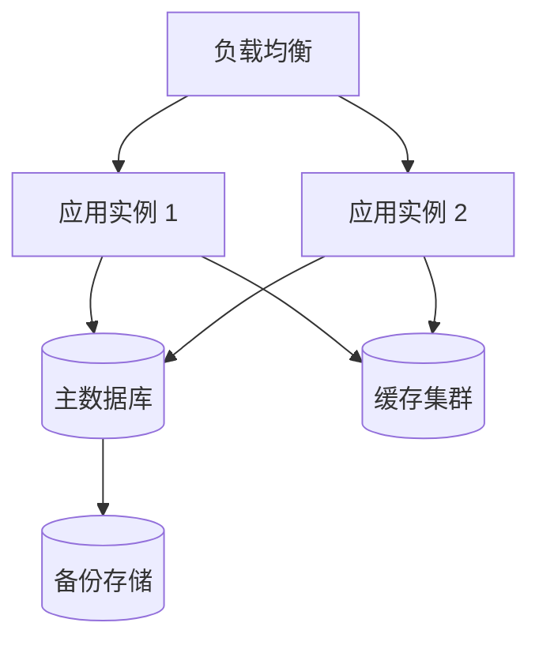

# 部署与运行

> 适用范围：部署拓扑、环境、发布、灰度、回滚
> 上游文档：[架构总览](../architecture/overview.md)
> 开发规范：[架构编码规范 §5 可回滚与灰度编码规范](../architecture/development-standards.md#5-可回滚与灰度编码规范)
> 目标读者：运维 / SRE / 开发值班人员

## 1. 部署拓扑

- 运行环境：自建
- 部署方式：容器编排
- 多环境：dev / uat / prod

## 2. CI/CD

- 流水线阶段：安装依赖 → lint → typecheck → test → build → 镜像构建 → 部署到 uat → 审批 → 部署到 prod。
- 构建产物：容器镜像，带版本号与 Git commit。
- 部署工具：按实际平台填写。
- 失败处理：任一阶段失败即终止，不进入下一阶段。

## 3. 发布策略

### 3.1 蓝绿部署

- 两套环境切换，降低发布风险。
- 切换前完成健康检查与冒烟测试。
- 切换后保留旧环境一段时间，便于快速回滚。

### 3.2 金丝雀发布

- 先放小流量到新版本，观察指标后再逐步放大。
- 观察指标：错误率、P95/P99 延迟、业务指标。
- 异常时自动或手动回滚。

### 3.3 功能开关

- 新功能必须支持功能开关。
- 开关默认关闭，灰度后逐步放开。
- 开关必须有负责人、清理时间和默认值。
- 禁止长期保留已下线功能的开关。

## 4. 回滚策略

### 4.1 回滚原则

- 发布方案必须包含回滚条件、步骤和负责人。
- 回滚优先切流量或关闭开关，其次回滚应用版本。
- 数据库变更必须兼容旧版本。
- 回滚目标：5 分钟内恢复。

### 4.2 回滚条件

- 错误率超过阈值。
- P99 延迟超过目标值持续。
- 核心业务功能不可用。
- 数据异常或数据丢失风险。

### 4.3 回滚步骤

1. 确认回滚条件触发。
2. 通知相关方。
3. 切流量或关闭功能开关。
4. 若无效，回滚应用版本。
5. 验证核心功能恢复。
6. 记录故障并复盘。

### 4.4 数据库回滚

- 数据库变更采用 `expand-contract`，保证旧版本可运行。
- 禁止在发布中直接删除旧字段。
- 回滚时应用版本可回退，数据库保持向前兼容。
- 数据迁移脚本必须可重复执行、可回滚或向前兼容。

## 5. 发布检查清单

- [ ] lint / test / build 通过
- [ ] 数据库迁移向后兼容
- [ ] 功能开关已配置
- [ ] 监控与告警已接入
- [ ] 回滚方案已确认
- [ ] 负责人已明确
- [ ] 发布窗口已确认

## 6. 相关文档

- 可观测性：[observability.md](./observability.md)
- 外部依赖与集成：[dependencies.md](./dependencies.md)
- 安全与合规：[security.md](./security.md)
- 架构概览：[架构总览](../architecture/overview.md)

## 📅 更新记录

> 只记重要变更，最新在上。完整历史见 Git。
